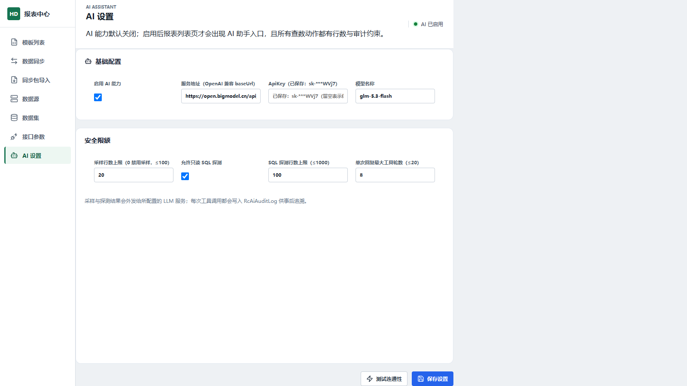
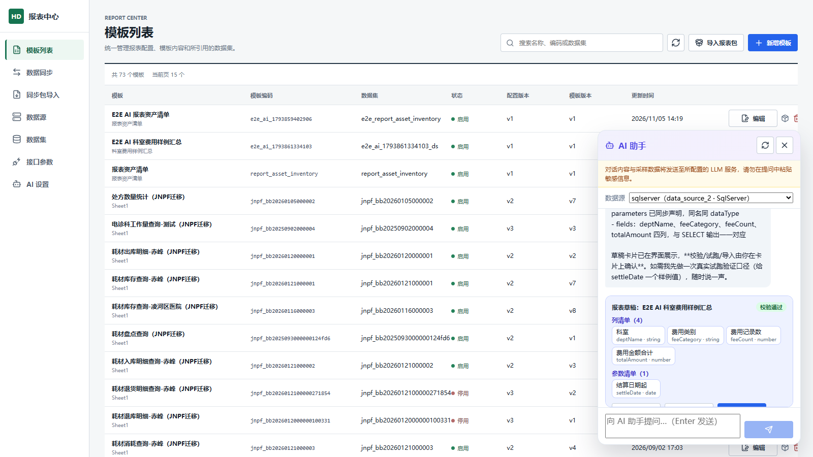
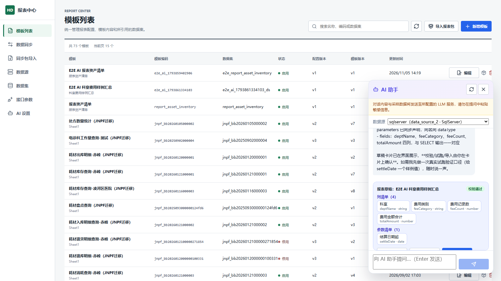
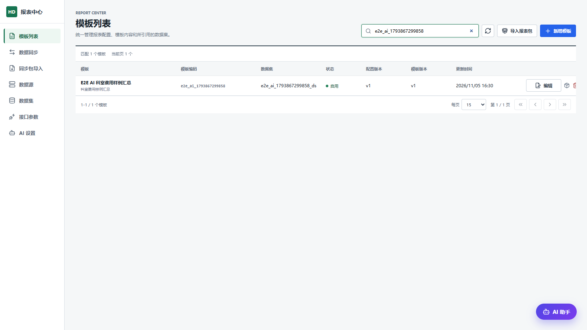
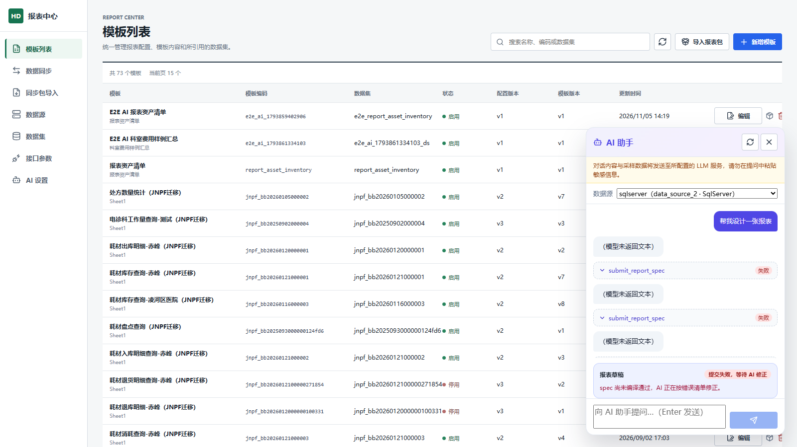
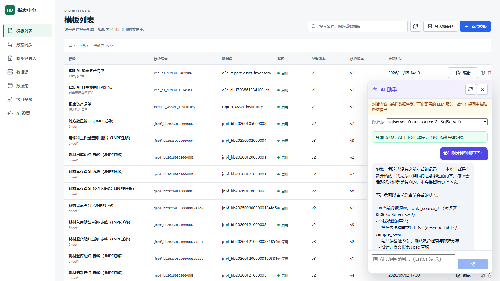
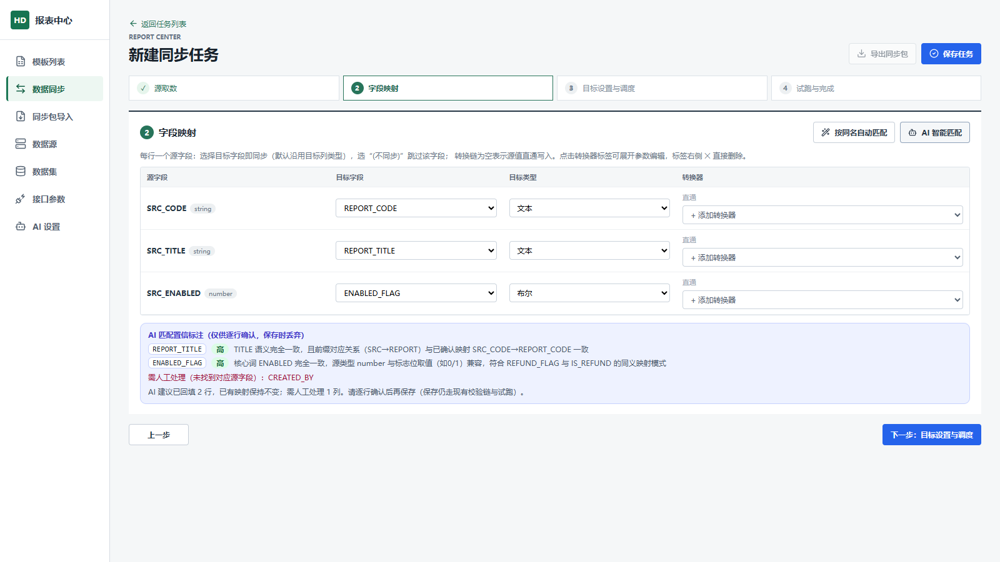
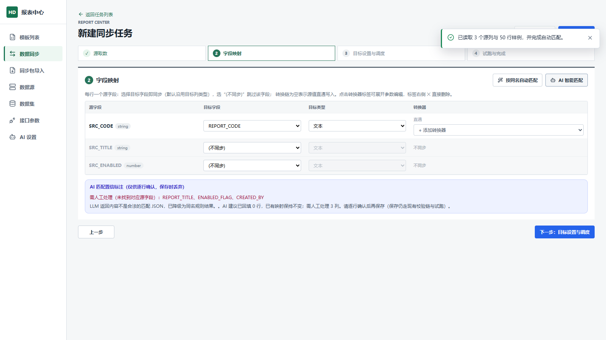

# AI 助手使用说明

> 适用对象：报表中心管理员 / 实施人员 / 业务用户
> 功能入口：模板列表页右下角「AI 助手」浮钮（模板 AI）；左侧菜单「AI 设置」（管理员配置）；「数据同步」设计器步骤 2 的「AI 智能匹配」按钮（同步 AI）
> 模块能力：用自然语言让 AI 查库摸数据并生成报表草稿（查表结构 → 采样 → 生成 spec → 校验 → 试跑 → 导入）；同步任务字段映射一键智能匹配（同名基线 + 语义补齐 + 转换链建议）。
> 前提须知：**AI 能力默认关闭**，需管理员在「AI 设置」页启用后才可见任何入口；AI 关闭时报表中心其余功能完全不受影响。

---

## 第一部分：管理员——启用与配置 AI

### 1. 启用前提

1. 已执行 `scripts/database/Apply-AiAssistantSchema.ps1`（建 `RcAiSettings` / `RcAiAuditLog` 两张表，幂等可重复执行）。
2. 有一个可访问的 **OpenAI 兼容**大模型服务地址（baseUrl），例如：
   - GLM 通用端点：`https://open.bigmodel.cn/api/paas/v4`（模型如 `glm-5.3-flash`）；
   - 内网自部署 vLLM / Ollama / OneAPI 网关，同样填 `{服务地址}/模型名/密钥` 三项即可，无需改代码。

### 2. 首次启用

AI 关闭时前端没有任何 AI 入口（这是有意的零感知设计），**首次启用走接口**（或直接改库）：

```bash
curl -X POST http://<报表中心地址>/api/report-center/ai/settings \
  -H "Content-Type: application/json" \
  -d '{"isEnabled":true,"baseUrl":"https://open.bigmodel.cn/api/paas/v4","apiKey":"<你的key>","model":"glm-5.3-flash","sampleRowLimit":20,"sqlProbeEnabled":true,"sqlProbeRowLimit":100,"maxToolRounds":8}'
```

启用后左侧菜单出现「AI 设置」，模板列表页右下角出现「AI 助手」浮钮。

### 3. 「AI 设置」页各项含义

| 配置项 | 含义 |
|---|---|
| 启用 AI 能力 | 总开关。关闭时所有 AI 接口直接拒绝（AI_DISABLED），前端入口全部隐藏 |
| 服务地址（baseUrl） | OpenAI 兼容服务地址，如 `https://open.bigmodel.cn/api/paas/v4`；必须是合法 http(s) 地址 |
| ApiKey | 服务密钥。**保存后打码回显**（`sk-***末4位`）；输入框留空保存 = 保留已存密钥，不会误清空 |
| 模型名称 | 如 `glm-5.3-flash`、`deepseek-chat`；启用时必填 |
| 采样行数上限（≤100） | `sample_rows` 工具单次采样的行数上限；**0 = 禁用采样工具** |
| 允许只读 SQL 探测 | 关闭后 AI 不能执行 `run_readonly_sql`（其余查表结构工具不受影响） |
| SQL 探测行数上限（≤1000） | `run_readonly_sql` 单次返回行数上限，读取侧截断 |
| 单次回复最大工具轮数（≤20） | 一轮 AI 回复内允许的"查数→再思考"循环次数，超限后强制 AI 给出结论 |

### 4. 连通性测试

填好并**保存**后，点「测试连通性」：系统对 baseUrl 发一次最小对话请求（30 秒超时），成功提示"连接成功，模型 xxx 已响应（xx ms）"；失败会给出可操作的原因（地址不可达 / 密钥错误 / 模型名不存在等）。

### 5. 数据外发与审计（管理员须知）

- 用户与 AI 的对话内容、采样出的数据行会**发送给所配置的 LLM 服务**——医疗环境请确认端点为内网自部署或合规可用后再启用。
- 每次工具调用（查表结构、采样、只读 SQL、spec 提交）与每次同步匹配都会写一行审计到 `RcAiAuditLog`（含 SQL 文本、行数、耗时），可按会话号/时间排查。
- 审计与日志中不含 ApiKey 与连接串。

---

## 第二部分：模板 AI——自然语言设计报表

### 1. 发起对话

模板列表页 → 右下角「AI 助手」浮钮 → 顶部先**选择数据源**（决定 AI 的查数范围）→ 底部输入框描述需求。



> 提示词建议：直接说清"要什么表、什么字段、按什么汇总"，并明确"请用工具查表结构后提交 spec"。数据源里的表较多时，直接点名目标表能明显加快速度。

### 2. 看懂工具过程

AI 每次查数都会在消息流里留下一条**工具折叠条**（工具名 · SQL 摘要 · 行数），点击可展开看执行的 SQL 或采样结果：

- `list_data_sources`：列出可用数据源（不含连接串）；
- `describe_table`：看表结构（列名/类型/注释）；
- `sample_rows`：采样前 N 行确认字段取值；
- `run_readonly_sql`：验证性只读查询（受只读校验器 + 行数上限约束）；
- `submit_report_spec`：提交报表草稿（编译 + 全链校验）。



### 3. 草稿卡片：校验 → 试跑 → 导入

AI 提交 spec 后出现**报表草稿卡片**：状态徽标（校验通过 / 试跑通过 / 已提交待确认 / 提交失败等待修正）、列清单、参数清单，以及三个按钮：

1. **校验**：服务端全链校验（复用报表包导入向导的校验链）；
2. **试跑**：用当前选中数据源真实执行（最多 50 行 / 30 秒，不落库），返回行数与字段契约比对结论；
3. **导入**：校验通过后可点（Create 模式导入报表 + 数据集 + 模板），成功后提示刷新模板列表；确认弹窗点"确定"即可。



### 4. 导入后

导入成功 → 回模板列表刷新 → 新报表出现，后续编辑、预览、导出与手工创建的报表完全一致。



### 5. 失败与熔断

- AI 提交的 spec 编译/校验失败时，错误清单会回传给模型自动修正（消息流可见失败的 submit 记录）；
- 同一会话**连续 3 次提交失败会熔断**：AI 会明确提示改用离线流水线（ZCode + report-design skill）人工介入，请照做，不要继续重试。



### 6. 会话管理

- 会话空闲 **30 分钟**自动过期；过期后再发消息会提示"会话已过期，AI 上下文已清空，本轮已按新会话继续"，历史消息仅本地保留展示。



- 侧栏右上角 ↻ 按钮可随时手动结束会话（清空服务端上下文）。

---

## 第二部分（续）：附件参考——用现成物料"照着做"

### 1. 上传附件

在 AI 助手侧栏输入框左侧点 📎（回形针）按钮，选择参考文件：

- **支持类型**：Excel（.xlsx）、PDF（.pdf，需有文本层）、图片（.png/.jpg/.jpeg/.webp）；
- **数量**：单条消息最多 3 个；
- **大小**：图片 ≤5MB，Excel/PDF ≤10MB（前端与后端双重拦截）；
- 附件随消息内联发送，**不落库**，随会话过期自动清空；审计只记文件名/类型/大小。

上传后输入框上方出现**附件条**（文件名+大小），点 ✕ 可撤回。

### 2. 三类附件怎么用

| 类型 | AI 能看到什么 | 适合场景 |
|---|---|---|
| Excel (.xlsx) | 表头行探测出的**列名与列序**、标题、合并单元格摘要、合计行线索（数据值不外发，仅推断类型） | "照着这张月报的列做一个汇总模板" |
| PDF | 文本层的行与切列结果（扫描版无文本层会被拒绝，提示转传图片） | 参考件是文字版 PDF 报表 |
| 图片 | 视觉模型识别的列名/列序/标题（`glm-5.3-flash` 主模型原生支持，无需另配视觉模型） | 报表截图、拍照件 |

### 3. 提需求的正确姿势

1. 上传附件后，在文字里明确"**列名列序严格按参考件**"以及数据从哪来（例如"汇总样例表 X 的费用数据"）；
2. AI 会先查库确认字段口径，再生成对齐参考的草稿——参考列名与库字段名不一致时，AI 以库字段为准并在回复中说明映射；
3. 参考里出现但库里确实没有的列，AI 会说明原因而不是硬造——属正常行为。


### 4. 注意事项

- 模板版式仍是标准骨架（标题行/参数行/表头行/明细行/合计行），AI 不会复刻参考件的合并单元格或自由版式；
- 视觉解析失败（图片模糊/视觉服务不可用）时不中断会话，AI 会提示"已按纯文本继续"，可重传更清晰的图片或改传 Excel；
- 附件内容会发送给所配置的 LLM 服务，**敏感凭证类图片请勿上传**。

---

## 第三部分：同步 AI——字段映射智能匹配

### 1. 入口与前提

数据同步设计器 → 步骤 2「字段映射」→ 工具栏「AI 智能匹配」按钮（AI 关闭时该按钮不显示，"按同名自动匹配"始终可用）。

前提：已完成步骤 1 的源取数（预览源列）并且步骤 3 已选定目标表（目标列清单来自真实表结构）。

### 2. 匹配结果怎么读

点「AI 智能匹配」后，表格下方出现**置信标注面板**：

- 每条建议带 **高 / 中 / 低** 置信徽标与依据说明（如"费用类别语义一致"）；
- 目标列在源表找不到对应字段时，列入"**需人工处理**"清单，**不会**写入映射；
- **只填空、不覆盖**：人工已填的映射原样保留，AI 只补空白行。



### 3. 确认与保存

逐行核对置信标注（尤其是"中/低"），可继续手工调整；确认无误后正常点「保存任务」——保存、试跑与运行都走既有校验链，AI 只参与"建议"，不直接改库。

### 4. 降级说明

LLM 服务不可用或返回内容异常时，匹配**自动降级为同名规则结果**并在面板中提示"已降级"——同名命中的照常回填，未命中的列入需人工处理。此时可检查 AI 设置后重试。



---

## 第四部分：常见问题

| 现象 | 原因与处理 |
|---|---|
| 看不到「AI 助手」浮钮 /「AI 设置」菜单 | AI 未启用。首次启用需管理员调 `POST /ai/settings`（见第一部分），启用后入口自动出现 |
| 连通性测试失败：地址不可达 | baseUrl 写错或网络不通；注意 baseUrl 要填到 `/v1`（或对应版本段），系统自动拼 `/chat/completions` |
| 连通性测试失败：HTTP 401 | ApiKey 错误或过期；重新填写（注意留空=保留旧值，换 key 要输入新值） |
| AI 只回复文字不动手查数 | 真实模型的编排有随机性。直接追问"请调用 xxx 工具"/"请提交 spec"推动它继续即可；同一会话最多 8 轮工具调用 |
| 提示"本会话已连续 3 次提交失败被熔断" | AI 反复生成不合格 spec。按提示改用离线流水线人工介入，或结束会话（↻）后换更明确的描述重开 |
| 提示"会话已过期" | 会话空闲 30 分钟自动清理；直接继续对话即可，本轮按新会话重建上下文 |
| 同步设计器没有「AI 智能匹配」按钮 | 同上，AI 未启用；规则版"按同名自动匹配"不受影响，可正常使用 |
| 匹配面板提示"已降级" | LLM 不可用或返回异常，已按同名规则给出结果；检查 AI 设置后可重试 |
| 担心数据外发 | 面板与设置页有常驻提示；可在设置页关掉采样/SQL 探测，或整体停用 AI |
| 附件按钮变灰转圈 | 附件正在读取/发送中，稍候；单条消息最多 3 个附件 |
| 上传附件提示"类型不受支持" | 仅允许 png/jpg/jpeg/webp 图片、xlsx Excel、有文本层的 PDF；扫描版 PDF 请截图后转传图片 |
| 上传附件提示"超过上限" | 图片 ≤5MB、Excel/PDF ≤10MB；超限请压缩或拆分 |
| AI 生成的模板没跟随参考件 | 在文字需求里明确"列名列序严格按参考件"并点名目标表；参考列与库字段不一致时以库字段为准 |
| 视觉模型回复解析失败 | 图片模糊或视觉服务不可用；已按纯文本继续，可重传清晰图片或改传 Excel（Excel 不依赖视觉模型） |
