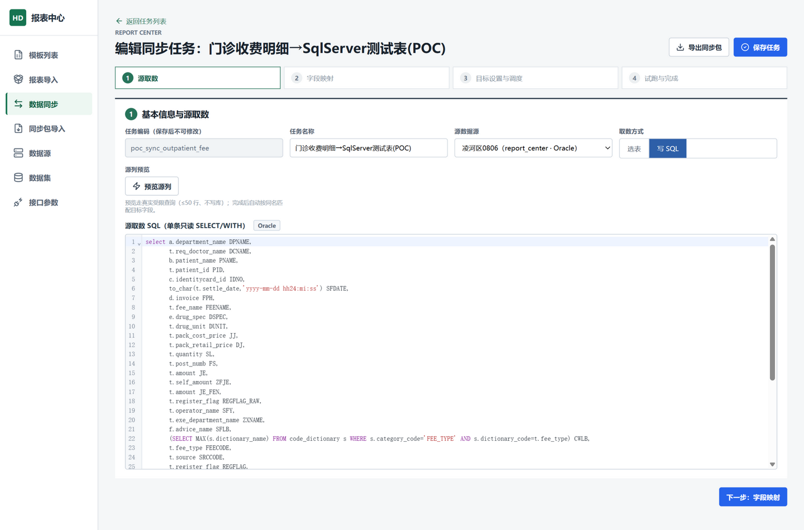
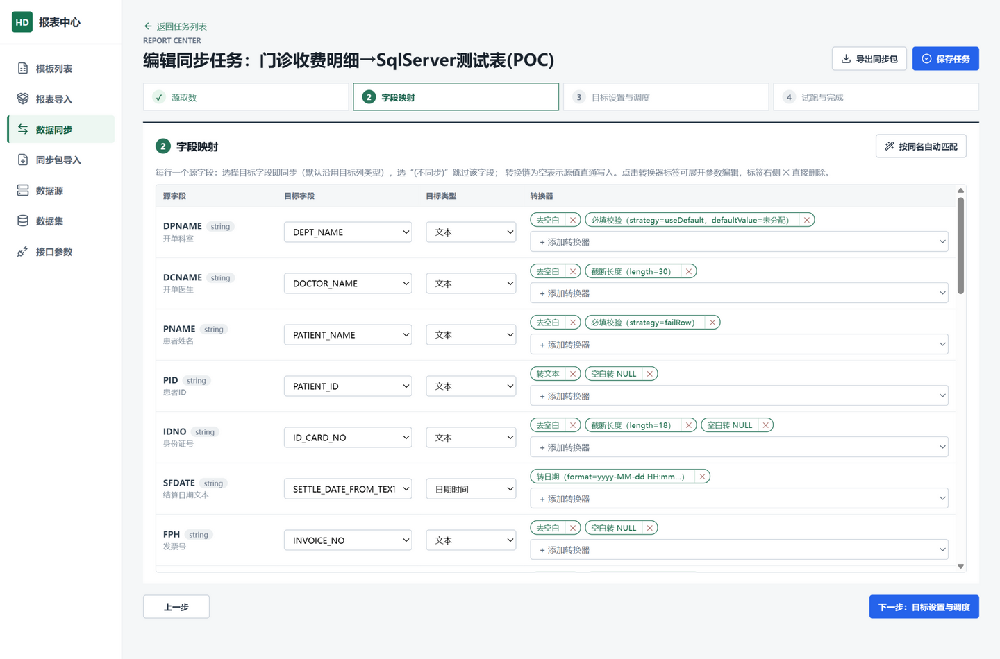
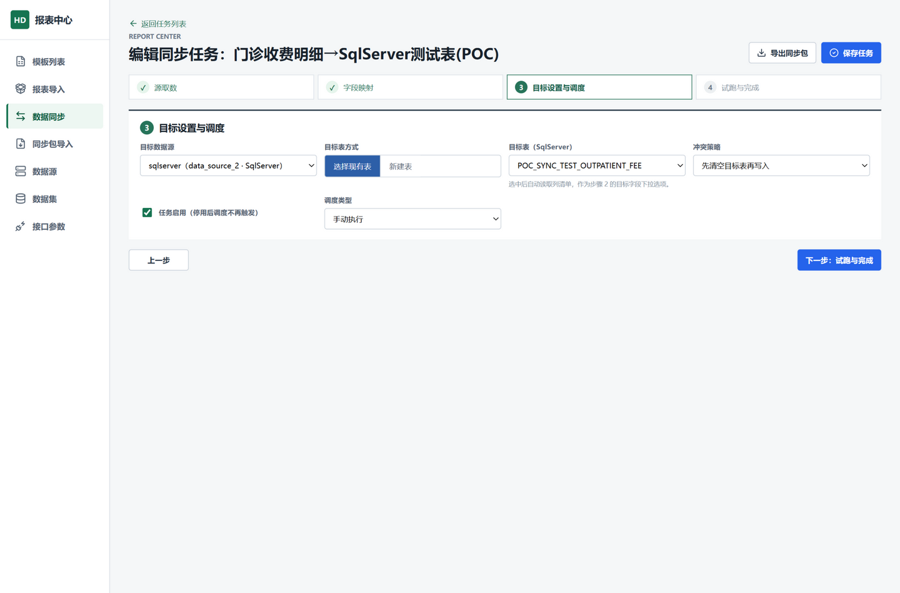
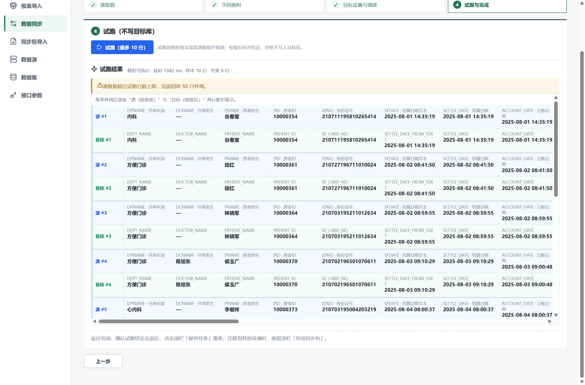
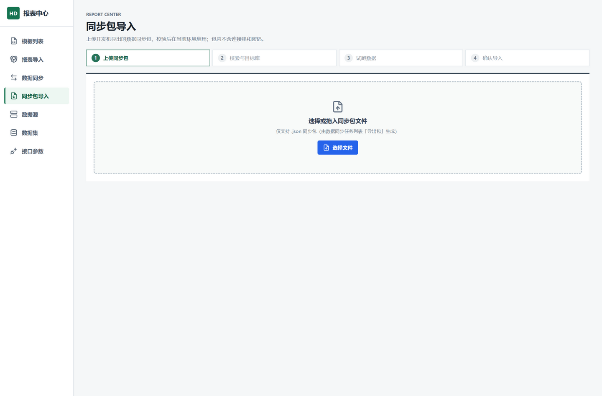

# 数据同步任务使用说明

> 适用对象：报表中心管理员 / 实施人员
> 功能入口：左侧菜单「数据同步」（任务设计与执行）、「同步包导入」（跨环境迁移）
> 模块能力：把任意支持库（SqlServer / Oracle / MySQL / PostgreSQL）的查询结果，按字段映射和转换规则，定时或手动批量写入另一个库；支持几千万级数据量；支持"本地设计 → 导出同步包 → 线上导入"的内网迁移模式。

---

## 第一部分：准备与源取数

### 1. 前置准备

1. 在「数据源」页面登记**源库**和**目标库**的连接（支持 SqlServer / Oracle / MySQL / PostgreSQL）。
2. 源取数可以复用「数据集」页面已有的数据集，也可以在设计器里直接选表或写 SQL（推荐后者，保存时系统会自动生成一个源数据集，编码为 `sync_src_<任务编码>`）。

### 2. 新建任务

「数据同步」页面 → 点「新建同步任务」，进入分步设计器。

### 3. 步骤 1：源取数

- **任务编码**：保存后不可修改，建议用业务含义命名（如 `sync_outpatient_fee`）。
- **源数据源**：下拉选择已登记的数据源。
- **取数方式**：
  - 「选表」：下拉选择源库中的表，系统自动生成只读查询；
  - 「写 SQL」：直接编写单条只读 SELECT/WITH 语句（支持 join、标量子查询；多个库的表需要用带库名/属主的写法）。
- **预览源列**：点击后真实执行（≤50 行、不写库），返回**动态字段列表**——字段名、类型、以及数据库里配置的列注释（中文含义）。这一步拿到的是最真实的字段清单，后面的映射全部基于它。

> 提示：SQL 里建议把"金额分转元""日期格式化"这类能下推的转换直接写进 SELECT；**不适合下推的**（字典翻译、非空校验、按行校验拦截）留到步骤 2 挂转换器。

---

## 第二部分：字段映射与转换器

### 步骤 2：字段映射（表格化，无需逐个拉线）

- 每行一个源字段：**字段名 + 类型徽标 + 数据库注释**（中文含义一目了然）。
- **目标字段下拉**：选项来自目标表的真实列，每项带注释（如 `CARD_NO · 卡号`）。
- **按同名自动匹配**：点一下（或预览源列后自动执行），源字段与目标列同名的全部自动对齐，通常只需要人工检查少数几行。
- **不需要同步的字段**：目标字段选「(不同步)」，该行置灰跳过。
- **转换器按需添加**：默认"直通"（源值原样写入）；需要转换时点「＋添加转换器」下拉选择：

| 转换器 | 用途 | 示例参数 |
|---|---|---|
| 转数字 / 转小数 | 字符串→数值，指定小数位 | scale=2 |
| 转日期 | 按格式解析字符串日期 | format=yyyy-MM-dd HH:mm:ss |
| 去空白 / 转文本 / 空白转NULL / 空值默认 | 清洗 | 默认值 `0` |
| 必填校验 | 空值时"填默认值"或"拦截该行并记录" | 策略+默认值 |
| 截断长度 | 防止超长写入失败 | length=50 |
| 字典映射 | 码值翻译，如 `14`→`诊疗费` | items JSON |
| 表达式（自定义） | DynamicExpresso 表达式，`value` 为输入 | `Convert.ToDecimal(value) * 100`（元转分） |

- 转换器以标签形式串成**转换链**（从上到下依次执行），点标签展开参数编辑，✕ 删除。
- **新建目标表**模式：在步骤 3 选择"新建表"后，这里目标字段默认等于源字段名，可修改；保存后引擎按映射自动建表（类型自动翻译成目标库方言）。

### 步骤 3：目标设置与调度

- **目标数据源** + **目标表方式**：
  - 「选择现有表」：下拉列出目标库全部表，选中自动读取列清单作为步骤 2 的下拉选项；
  - 「新建表」：手填表名，首次执行自动建表。
- **冲突策略**：`先清空目标表再写入`（全量重灌）或 `追加写入`。
- **调度**：手动执行 / 每天定时（HH:mm）/ 固定间隔（N 分钟）。启用的任务由系统调度器每分钟扫描到期自动执行。

---

## 第三部分：试跑、执行与同步包迁移

### 步骤 4：试跑（不写目标库）

- 点「试跑（最多 10 行）」：真实读源、按映射转换、校验目标列，**绝不写入目标库**。
- 结果按**逐条记录上下配对**展示：蓝色「源 #n」行是转换前的原始值，绿色「目标 #n」行是转换后的落库值，**上下按映射关系垂直对齐**——比如字典转换 `FEECODE=14` 正对着 `FEE_CATEGORY_NAME=诊疗费`，一眼可查。
- 面板头部给出结论（映射可执行/耗时/样本行数/失败行数）；失败明细含行号、字段、原因、原始值。

### 保存与执行

- 确认试跑结论无误后，点顶栏「保存任务」落库（保存走修订号乐观锁）。
- 执行方式：
  - **手动**：列表页「立即执行」；
  - **定时**：按步骤 3 的调度自动执行（错峰建议凌晨）。
- 列表页「运行记录」可查每次执行的读取/写入/失败行数、失败明细（前 200 条）与消息；失败行不会写入目标表，按策略跳过或中止。

### 同步包迁移（本地设计 → 线上运行）

1. 本地确认任务可用后，列表页或设计器顶栏「导出同步包」，得到 `任务编码.sync-package.json`（**不含任何连接串和密码**，已验证）。
2. 把包文件拷贝进内网生产环境。
3. 线上「同步包导入」页面：上传包 → 服务端校验（结构/映射/目标数据源类型/冲突探测）→ 试跑（限 50 行真实转换）→ 确认导入（新建/替换）。
4. 导入后在线上按同样方式配调度即可运行。

### 常见注意点

- **数据量**：流式分批读写（约 4000 行/批读、10000 行/批写），内存占用恒定；几千万级全量建议安排在业务低峰。
- **类型差异**：`datetime` 毫秒在 Oracle `DATE` 会丢（用 TIMESTAMP）；`nvarchar(50)` 是字符数、`VARCHAR2(50)` 默认是字节数，新建表已按字符数放大，选现有表时注意列宽。
- **幂等重跑**：全量任务失败后直接重跑即可（TruncateFirst 会先清空）；字典未命中的值会按失败行拦截并记录，补全字典映射后重跑。
- **新增字段**：源结构变化后重新"预览源列"，在映射表格里补一行映射即可，无需重建任务。
